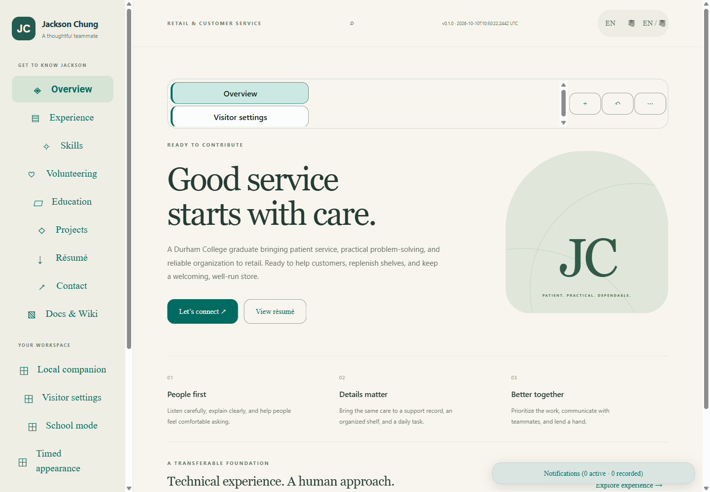

# Jackson Chung

A retail-focused professional profile and local desktop companion, with selected public projects, a downloadable public résumé, bilingual visitor controls, and local tools.

Implementation is in progress. The public portfolio deployment is verified at its recorded source. Complete feature coverage, installed workflows, production integration and updater acceptance remain separate milestones.

Public contact information is limited to email and Toronto. The original supplied résumé is private and is not included here.

## Selected projects

- [Desktop Material](https://github.com/Ding-Ding-Projects/desktop-material)
- [Worldlens](https://github.com/Ding-Ding-Projects/worldlens)
- [GTHA Transit](https://github.com/Ding-Ding-Projects/gtha-transit)
- [Material UniGetUI](https://github.com/Ding-Ding-Projects/material-unigetui)
- [Material System Care](https://github.com/Ding-Ding-Projects/material-system-care)
- [yt-dlp Studio](https://github.com/Ding-Ding-Projects/material-ytdlp)

Descriptions retain each project's development limitations. Inclusion does not claim sole authorship or certify production completeness.

## Build and use

On Windows, run `build.bat /s` to build the shared static renderer. Run `build-installer.bat /s` to produce the unsigned Squirrel.Windows desktop package. The entrypoints obtain missing supported tooling through verified official routes and propagate real failures. Fresh-machine bootstrap has not been verified.

The verified public home is [Jackson Chung](https://ding-ding-projects.github.io/jackson-chung/). A fresh readback returned HTTP 200 at deployed source `faffef21` and confirmed the exact repository About URL. Browser tools keep their files and credentials locally. Native machine access requires the desktop companion and explicit capability grants.

## Documentation and verification

[Documentation](docs/README.md), [wiki source](wiki/Home.md), [roadmap](ROADMAP.md), and [handoff](HANDOFF.md) distinguish implemented behavior from missing features and unverified evidence. The website bundles every checked-in documentation and wiki article for internal reading.

Local verification at source `cee79f8` includes 167 passing checks and TypeScript. Complete package inspection covers 533 entries and 443 staged payload files, with all 46 build processes independently accounted for. The separate installed verification candidate passed encrypted-record persistence, dirty Save and close, and clean caption close without an error dialog. These bounded results do not establish production integration, updater, uninstall, fresh-machine bootstrap or complete contract acceptance. The completeness checker remains red, with 297 missing or unverified surface requirements.

[Task and handoff](https://github.com/Ding-Ding-Projects/jackson-chung/issues/1) · [Progress discussion](https://github.com/Ding-Ding-Projects/jackson-chung/discussions/2)

## Inspected browser homepage

This genuine, unedited browser capture shows the built Home surface at source `9c654dc`, English and light theme, 1440 by 1000 CSS pixels and requested pixel ratio one. The capture contains public profile content only. It demonstrates this visible state, not full-page layout, native operating-system scaling, installer or complete product acceptance. Separate browser checks at source `f2f3a70` cover complete-article search, retained navigation and resource hashes, and bounded attention layouts.

## Inspected installed workflow

This genuine, unedited capture shows the installed `cee79f8` verification candidate at 1200 × 752 CSS pixels and 150% scale (1800 × 1128 captured pixels), light theme and English. It contains only public profile text and a synthetic record. Save and close subsequently exited zero; a relaunch loaded the saved record and a clean caption close exited zero. [Evidence details](docs/features/delivery/installed-verification.md) keep the scope and limitations explicit.
