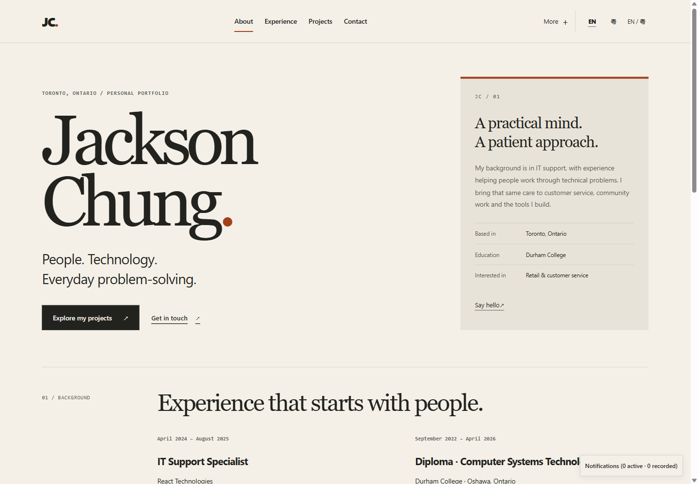
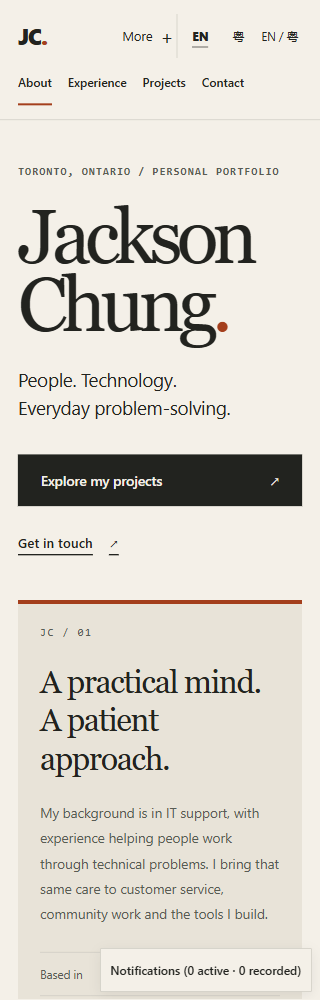
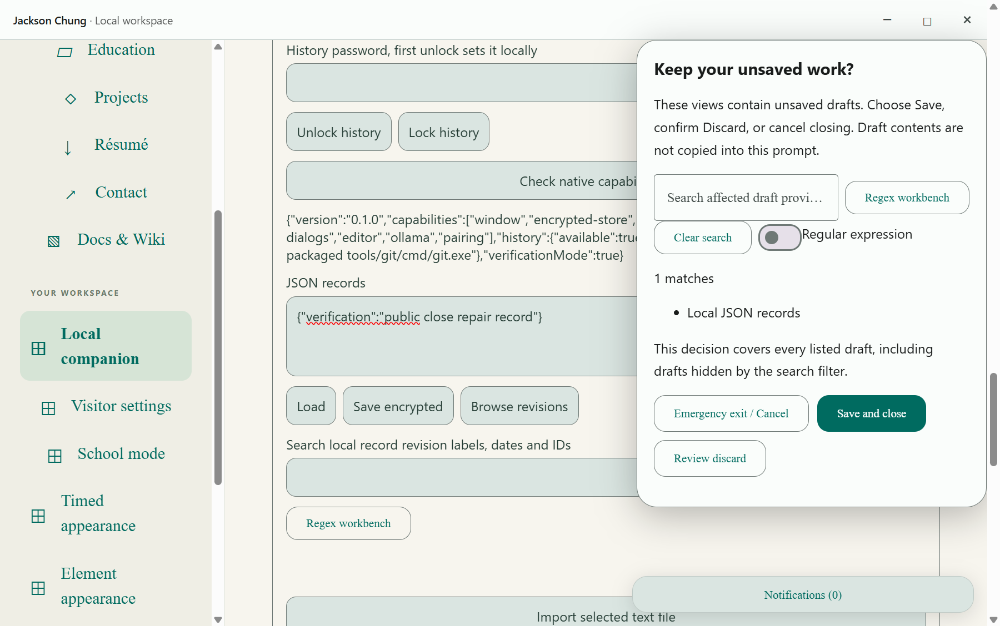

# Jackson Chung

Jackson Chung’s personal portfolio: IT support experience, selected public projects, community work and a downloadable public résumé. An editorial ink-and-paper design puts the person and work first, with bilingual controls and supporting local tools in secondary navigation. The separately installable desktop companion remains a working interface.

Implementation is in progress. The public portfolio deployment is verified at its recorded source. Complete feature coverage, installed workflows, production integration and updater acceptance remain separate milestones.

Public contact information is limited to email and Toronto. The original supplied résumé is private and is not included here.

## Selected projects

- [Desktop Material](https://github.com/Ding-Ding-Projects/desktop-material)
- [Worldlens](https://github.com/Ding-Ding-Projects/worldlens)
- [GTHA Transit](https://github.com/Ding-Ding-Projects/gtha-transit)
- [Material UniGetUI](https://github.com/Ding-Ding-Projects/material-unigetui)
- [Material System Care](https://github.com/Ding-Ding-Projects/material-system-care)
- [yt-dlp Studio](https://github.com/Ding-Ding-Projects/material-ytdlp)

Descriptions retain each project's development limitations. Inclusion does not claim sole authorship or certify production completeness.

## Build and use

On Windows, run `build.bat /s` to build the shared static renderer. Run `build-installer.bat /s` to produce the unsigned Squirrel.Windows desktop package. The entrypoints obtain missing supported tooling through verified official routes and propagate real failures. Fresh-machine bootstrap has not been verified.

The public home is [Jackson Chung](https://ding-ding-projects.github.io/jackson-chung/), hosted on GitHub Pages. The preceding verified deployment was 386410d; the editorial redesign's built evidence is recorded below. Its new live deployment is verified separately from source and capture checks. Browser tools keep their files and credentials locally. Native machine access requires the desktop companion and explicit capability grants.

## Documentation and verification

[Documentation](docs/README.md), [wiki source](wiki/Home.md), [roadmap](ROADMAP.md), and [handoff](HANDOFF.md) distinguish implemented behavior from missing features and unverified evidence. The website bundles every checked-in documentation and wiki article for internal reading.

Local verification at source `cee79f8` includes 167 passing checks and TypeScript. Complete package inspection covers 533 entries and 443 staged payload files, with all 46 build processes independently accounted for. The separate installed verification candidate passed encrypted-record persistence, dirty Save and close, and clean caption close without an error dialog. These bounded results do not establish production integration, updater, uninstall, fresh-machine bootstrap or complete contract acceptance. The completeness checker remains red, with 297 missing or unverified surface requirements.

[Task and handoff](https://github.com/Ding-Ding-Projects/jackson-chung/issues/1) · [Progress discussion](https://github.com/Ding-Ding-Projects/jackson-chung/discussions/2)

## Inspected portfolio homepage

These genuine, unedited captures show the built editorial portfolio at source 3141dad, English and light theme, requested pixel ratio one. The originals were inspected and staged byte for byte. A separate 96-tuple Home/Projects matrix covers 320/1440 CSS pixels, three language modes, two device-emulated themes and four emulated pixel ratios. Recorded body widths fit and captured accessibility trees had no unnamed interactive entries. This does not establish native operating-system scaling, physical-device behavior or every control. More opening, Escape focus return and profile/document navigation passed; palette close-focus and reload persistence remain unverified after the later strict target-isolation stop. Owned processes and desktop closed, profiles retained. The former homepage capture remains historical, not current redesign evidence.

## Inspected installed workflow

This genuine, unedited capture shows the installed `cee79f8` verification candidate at 1200 × 752 CSS pixels and 150% scale (1800 × 1128 captured pixels), light theme and English. It contains only public profile text and a synthetic record. Save and close subsequently exited zero; a relaunch loaded the saved record and a clean caption close exited zero. [Evidence details](docs/features/delivery/installed-verification.md) keep the scope and limitations explicit.
